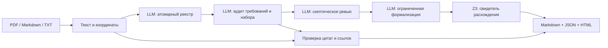

# AI AQYN

**Покажи сценарий, в котором ТЗ ломается.**

Агент статического ревью требований для BCC-HUB × MNU FinTech Hackathon. Читает PDF/Markdown/TXT, вызывает LLM, проверяет происхождение замечаний и ищет конкретные входные значения, при которых два правила требуют разных результатов.

## Почему это интересно

Обычный список замечаний трудно защищать перед аналитиком. AI AQYN превращает его в комнату доказательств:

- **Evidence room:** каждое замечание связано с дословным фрагментом и координатами источника.
- **Скептическое ревью:** второй проход пытается найти оправдывающее толкование или исключение. Сохраняются также отклонённые замечания.
- **Conflict witness:** Z3 находит один вход и два разных результата в предложенной целочисленной модели.
- **Decision agenda:** вопросы владельцу требований и альтернативы исправления без самовольного выбора бизнес-правил.
- **Честная неопределённость:** источник цитаты, решение LLM и проверка решателя показаны раздельно.

Это исследовательский прототип, не сертификация соответствия ISO. Формальная проверка ограничена точностью перевода текста в модель. Победа на хакатоне и мировая новизна не заявляются.

## Быстрый запуск

Требуется Python 3.11+ и [uv](https://docs.astral.sh/uv/getting-started/installation/).

```bash
git clone https://github.com/SaginbekDaniel/aiaqyn.git
cd aiaqyn
uv sync --frozen --extra dev --no-editable
cp .env.example .env
```

### Локально через Ollama

Установите [Ollama](https://ollama.com/), запустите его и загрузите модель:

```bash
ollama pull qwen3:4b
uv run --no-editable aiaqyn /absolute/path/requirements.md reports/review.md --provider ollama --model qwen3:4b
```

Компактная модель удобна для smoke-проверки, но не гарантирует качество анализа длинного документа. Для итогового прогона сравните её с более сильной доступной моделью. Требования к памяти зависят от размера модели и контекста; запросы отправляются локальному Ollama.

### Gemini

Получите ключ в [Google AI Studio](https://aistudio.google.com/apikey). В `.env` задайте `GEMINI_API_KEY`, `AQYN_PROVIDER=gemini`, `AQYN_MODEL` — точный идентификатор доступной вашему аккаунту модели. Ключ не попадает в отчёт или Git. Тарифы и квоты определяются провайдером.

```bash
uv run --no-editable aiaqyn /absolute/path/requirements.pdf reports/review.md
```

Получите `review.md`, `review.json` и автономный `review.html`. Откройте HTML в браузере. Интернет для просмотра не нужен; внешних скриптов и шрифтов нет.

Исходный документ организаторов доступен [здесь](https://github.com/BCC-HUB/ai-requirements-validator-task/blob/main/docs/requirements.md). Он не подменяется нашим учебным примером и не включён в репозиторий как результат разработки.

## Демо без модели

```bash
uv run --no-editable aiaqyn examples/mini.md reports/demo.md --fixture examples/mini.fixture.json
```

**Это явно помеченная тестовая фикстура, написанная разработчиком, а не ответ LLM и не отчёт для сдачи.** Фикстура привязана к SHA-256 одного синтетического документа. Заменить ею прогон другого документа нельзя. Готовый пример: [HTML](examples/demo-report.html), [Markdown](examples/demo-report.md).

## Архитектура



Это четыре последовательные роли одной модели, не четыре независимых эксперта. Структура ответа проверяется Pydantic. В стандартном успешном прогоне — четыре LLM-запроса, плюс ограниченные сетевые повторы. Ответ модели никогда не исполняется как Python/SMT-код.

## Проверки качества

```bash
uv run --no-editable pytest -q
uv run --no-editable ruff check .
uv run --no-editable ruff format --check .
```

Проверяются доказательства, контрпример, исправленная модель, недостижимые условия, неизвестные переменные, полнота оценок/ревью, дубли моделей, HTML injection и пустой PDF. CI выполняет те же проверки.

Метрики качества самого LLM требуют отдельной разметки и живого прогона. Прохождение unit-тестов не означает высокую точность обнаружения дефектов.

## Ограничения и поведение при ошибках

- PDF только с текстовым слоем; при пустой странице анализ останавливается с указанием необходимости OCR.
- Лимиты: 20 MB, 200 страниц PDF, 100 000 символов. Текст не обрезается молча.
- Полнота оценок проверяется относительно извлечённого реестра. Полнота извлечения относительно всего документа не доказана.
- Формальный DSL: ограниченные целые числа, условия сравнения, переменная плюс константа. Временные автоматы, произвольные формулы, строки и вероятностные свойства вне его области.
- Согласие ревьюера с первым проходом не гарантирует правильность: модель одна и та же.
- Поддельные цитаты, пропуски оценок и неверные ссылки останавливают прогон. Автоматической починки семантически некорректного ответа пока нет.
- При ошибке существующий отчёт от предыдущего прогона не удаляется. Сверяйте дату, хеш и код возврата; для сдачи используйте новый путь.
- Отчёт включает исходный текст. Внешний LLM получает документ; локальный Ollama позволяет обрабатывать его на компьютере.

## Материалы команды

- [Исследование и выбор концепции](docs/RESEARCH.md)
- [Соответствие заданию и план измерений](docs/ACCEPTANCE.md)
- [Сценарий защиты за 3 минуты](docs/PITCH.md)

Проект реализует собственную комбинацию идей, вдохновлённых опубликованными исследованиями; не воспроизводит их экспериментальные результаты.
